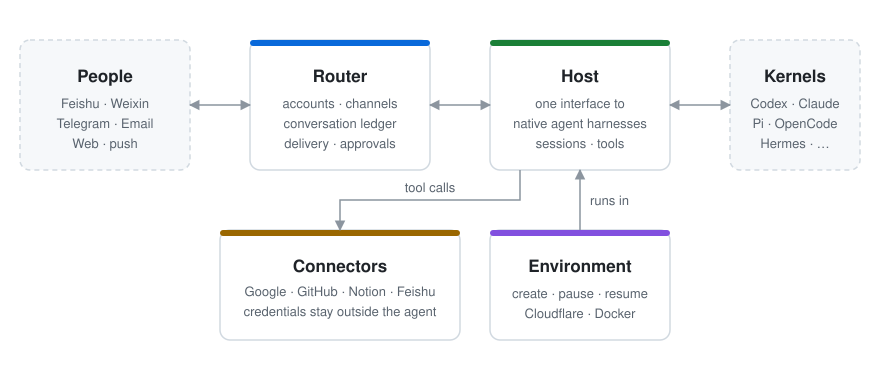

<div align="center">

# Agent Kit

**Four building blocks for products built on native coding agents.**

Reach an agent from any chat channel, run any agent harness behind one interface,
give it your services without giving it your credentials, and put it in a sandbox that pauses when idle.

[](https://github.com/Olorinm/agent-kit/releases)
[](LICENSE)
[](https://nodejs.org)



</div>

## The packages

Each package works on its own. Use one, or all four together.

| | Package | What it does |
| --- | --- | --- |
| 🔀 | [**Router**](packages/router) | A message router for agents. Owner accounts, chat channel connections (Feishu, Weixin, Telegram, email, web, push), one conversation ledger across them, delivery to a running agent and replies back to where each message came from. |
| 🧠 | [**Host**](packages/host) | One interface to seven native harnesses: Codex, Claude Agent, Pi, OpenCode, Kimi Code, Hermes and OpenClaw. Sessions, tools and approvals stay as each harness defines them. Embed it or run it as an HTTP service. |
| 🔌 | [**Connectors**](packages/connectors) | Google Workspace, GitHub, Notion, Feishu and a browser, exposed to agents as tools. Credentials and write approvals stay outside the agent's environment. |
| 📦 | [**Environment**](packages/environment) | Create, pause, resume and remove execution environments through one TypeScript API and CLI. Cloudflare containers in production, Docker on your own machine. |

Looking for a finished product built from these? See [Mau](https://github.com/Olorinm/mau).

## Quick start

The fastest way to see something work is Host with an agent you already have installed and signed in to
(here Codex). Node.js 24+:

```sh
mkdir my-agent && cd my-agent && npm init -y
npm install https://github.com/Olorinm/agent-kit/releases/download/v0.11.0-alpha.8/olorinm-agent-host-0.11.0-alpha.8.tgz

npx agent-host init --kernel codex --cwd . --config host.json
npx agent-host doctor --config host.json
npx agent-host run --config host.json --session first "Explain the files in this directory"
```

Then pick what you need next:

| I want to… | Start here |
| --- | --- |
| Run an agent from my backend, or over HTTP | [Host quick start](packages/host/docs/quickstart.md) |
| Let people message an agent from chat apps | [Router](packages/router/README.md) |
| Give an agent Gmail, GitHub or a browser, safely | [Connectors](packages/connectors/README.md) |
| Run agents in sandboxes, in the cloud or locally | [Environment](packages/environment/README.md) |

## Install

Packages are published as archives on [GitHub Releases](https://github.com/Olorinm/agent-kit/releases), not on the
npm registry. All four share one version and are released together.

| Package | npm name | Release asset |
| --- | --- | --- |
| Router | `@agent-router/server` | `agent-router-server-<version>.tgz` |
| Host | `@olorinm/agent-host` | `olorinm-agent-host-<version>.tgz` |
| Connectors | `@olorinm/agent-connectors` | `olorinm-agent-connectors-<version>.tgz` |
| Environment | `@olorinm/agent-environment` | `olorinm-agent-environment-<version>.tgz` |

```sh
npm install https://github.com/Olorinm/agent-kit/releases/download/v<version>/<asset>
```

Every release carries `SHA256SUMS` for its archives. What changed in each version: [CHANGELOG.md](CHANGELOG.md).

## Development

There is no root workspace. Install, test and build inside a package:

```sh
cd packages/host
npm ci
npm test
```

CI runs one workflow per package (`.github/workflows/ci-<package>.yml`) when that package changes.

<details>
<summary>Cutting a release</summary>

```sh
node scripts/set-version.mjs 0.11.0-alpha.8   # every package.json and lockfile
# add a "## [0.11.0-alpha.8]" section to CHANGELOG.md, commit, wait for CI
git tag v0.11.0-alpha.8 && git push origin v0.11.0-alpha.8
```

The [release workflow](.github/workflows/release.yml) builds every package at the tagged commit on Linux with a
pinned Node.js and npm and publishes one GitHub Release, whose notes are the `CHANGELOG.md` section for that
version. A tag may point at any commit whose checks have passed, including a branch still under review, so a
product can try a change before it is merged. Running the workflow manually builds and packs without publishing.

</details>

## License

[MIT](LICENSE). Packages may include additional notices in their own directories.
