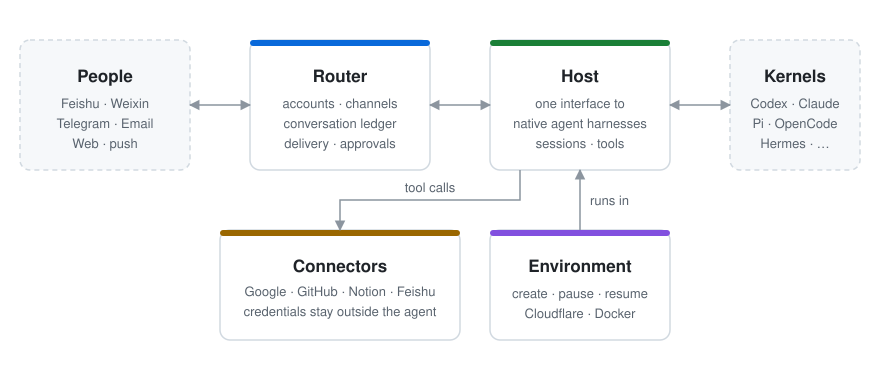

<div align="center">

# Agent Kit

[English](README.md) | **简体中文**

**用原生编程 Agent 做产品的四个积木。**

让人从任意聊天渠道找到 Agent，用同一个接口运行任意 Agent 内核，
让它用上你的各种服务却拿不到你的凭证，再把它放进一个空闲就暂停的沙箱。

[](https://github.com/Olorinm/agent-kit/releases)
[](LICENSE)
[](https://nodejs.org)



</div>

## 四个包

每个包都可以单独使用，也可以四个一起用。

| | 包 | 做什么 |
| --- | --- | --- |
| 🔀 | [**Router**](packages/router/README.zh-CN.md) | Agent 的消息路由。管理所有者账号和聊天渠道连接（飞书、微信、Telegram、邮件、网页、推送），各渠道共用一份对话账本；把收到的消息投递给运行中的 Agent，再把回复送回消息来的地方。 |
| 🧠 | [**Host**](packages/host/README.zh-CN.md) | 用同一个接口对接九种原生内核：Codex、Claude Agent、Pi、OpenCode、Kimi Code、Antigravity、DeepSeek Harness、Hermes 和 OpenClaw。会话、工具和审批都保持各内核自己的定义。可以嵌入你的后端，也可以作为 HTTP 服务运行。 |
| 🔌 | [**Connectors**](packages/connectors/README.zh-CN.md) | 把 Google Workspace、GitHub、Notion、飞书和浏览器作为工具提供给 Agent。凭证和写操作的审批都留在 Agent 的环境之外。 |
| 📦 | [**Environment**](packages/environment/README.zh-CN.md) | 用一套 TypeScript 接口和命令行创建、暂停、恢复、删除执行环境。线上用 Cloudflare 容器，本机用 Docker。 |

想找一个用这些积木搭好的成品？看 [Mau](https://github.com/Olorinm/mau/blob/main/README.zh-CN.md)。

## 快速开始

最快看到效果的办法，是用 Host 驱动一个你已经装好并登录的 Agent（这里用 Codex）。需要 Node.js 24+：

```sh
mkdir my-agent && cd my-agent && npm init -y
npm install https://github.com/Olorinm/agent-kit/releases/download/v0.11.0-alpha.13/olorinm-agent-host-0.11.0-alpha.13.tgz

npx agent-host init --kernel codex --cwd . --config host.json
npx agent-host doctor --config host.json
npx agent-host run --config host.json --session first "Explain the files in this directory"
```

接下来按你的需要选：

| 我想…… | 从这里开始 |
| --- | --- |
| 从我的后端或通过 HTTP 运行 Agent | [Host 快速开始](packages/host/docs/quickstart.md)（英文） |
| 让人从聊天软件给 Agent 发消息 | [Router](packages/router/README.zh-CN.md) |
| 安全地让 Agent 用上 Gmail、GitHub 或浏览器 | [Connectors](packages/connectors/README.zh-CN.md) |
| 在云上或本机的沙箱里运行 Agent | [Environment](packages/environment/README.zh-CN.md) |

## 安装

各个包以压缩包的形式发布在 [GitHub Releases](https://github.com/Olorinm/agent-kit/releases)，没有发布到 npm。
四个包共用一个版本号，一起发布。

| 包 | npm 名称 | 发布文件 |
| --- | --- | --- |
| Router | `@agent-router/server` | `agent-router-server-<version>.tgz` |
| Host | `@olorinm/agent-host` | `olorinm-agent-host-<version>.tgz` |
| Connectors | `@olorinm/agent-connectors` | `olorinm-agent-connectors-<version>.tgz` |
| Environment | `@olorinm/agent-environment` | `olorinm-agent-environment-<version>.tgz` |

```sh
npm install https://github.com/Olorinm/agent-kit/releases/download/v<version>/<asset>
```

每个版本都附带这些压缩包的 `SHA256SUMS`。每个版本改了什么见 [CHANGELOG.md](CHANGELOG.md)（英文）。

## 开发

没有根目录的 workspace。在某个包的目录里安装、测试和构建：

```sh
cd packages/host
npm ci
npm test
```

某个包有改动时，CI 只运行它对应的那一个工作流（`.github/workflows/ci-<package>.yml`）。

<details>
<summary>发布一个版本</summary>

```sh
node scripts/set-version.mjs 0.11.0-alpha.13   # 改每个 package.json 和锁文件
# 在 CHANGELOG.md 里加一节 "## [0.11.0-alpha.13]"，提交，等 CI 通过
git tag v0.11.0-alpha.13 && git push origin v0.11.0-alpha.13
```

[发布工作流](.github/workflows/release.yml)在 Linux 上用固定版本的 Node.js 和 npm，在打标签的那个提交上构建每个包，
并发布一个 GitHub Release，说明文字取自 `CHANGELOG.md` 里该版本的那一节。标签可以打在任何检查已通过的提交上，
包括还在评审中的分支，这样产品可以在合并之前先试用一个改动。手动运行这个工作流只构建和打包，不发布。

</details>

## 许可

[MIT](LICENSE)。各个包的目录里可能有额外的声明。
